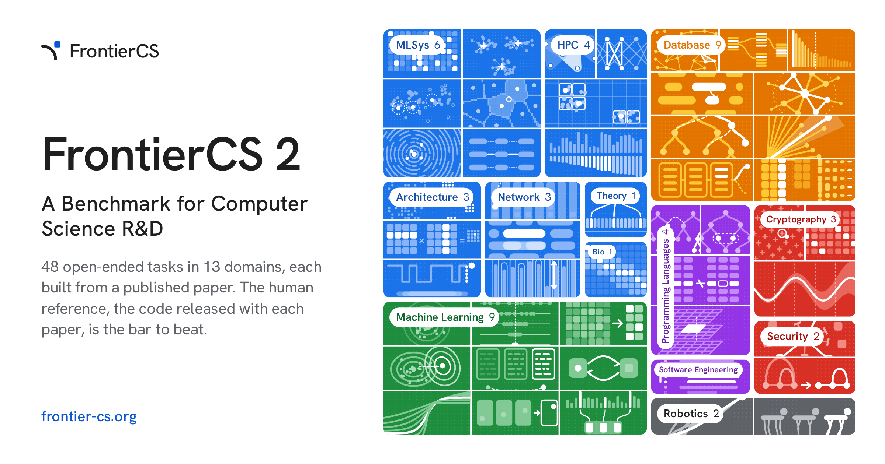
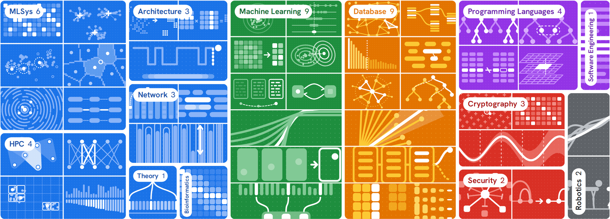
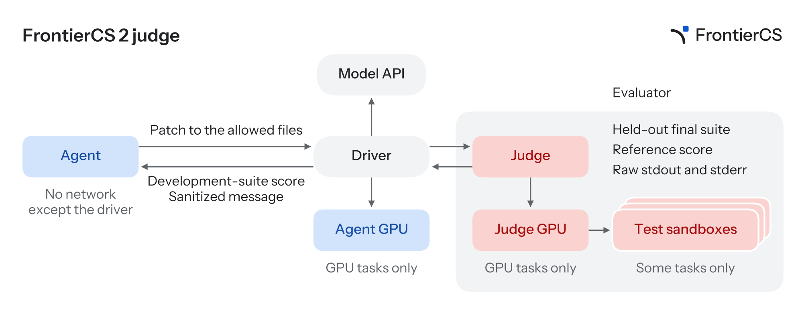
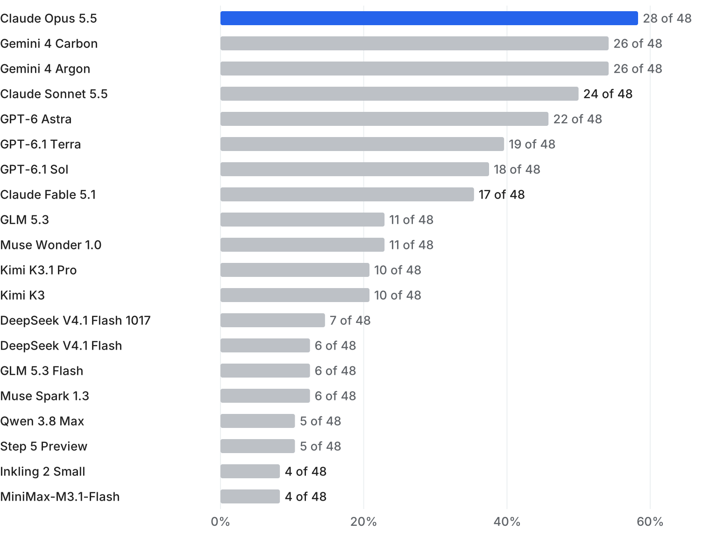
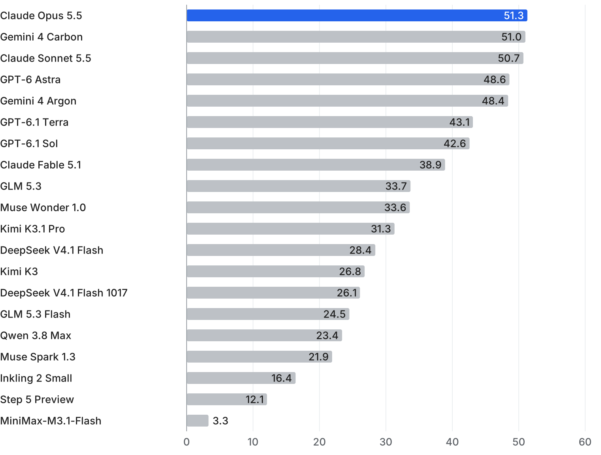
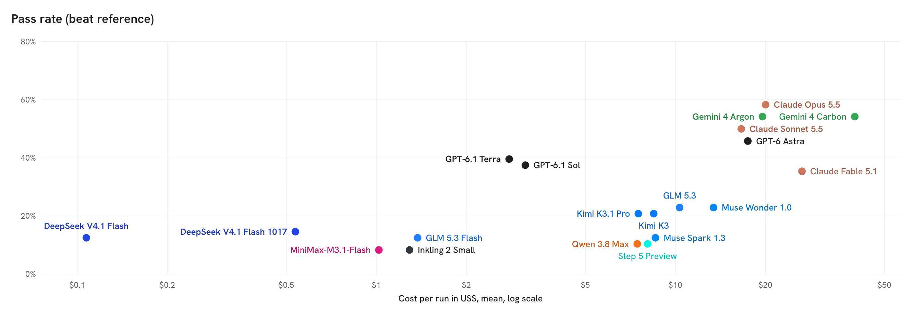
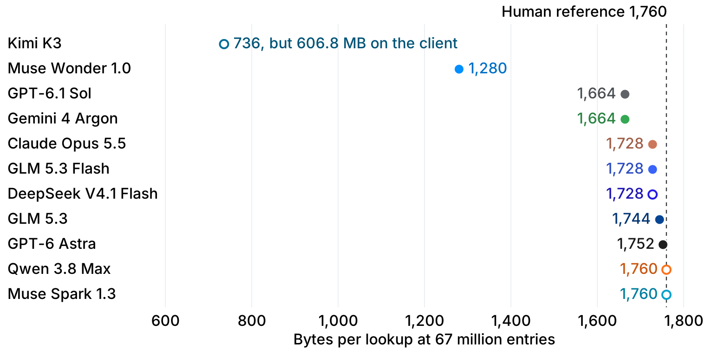
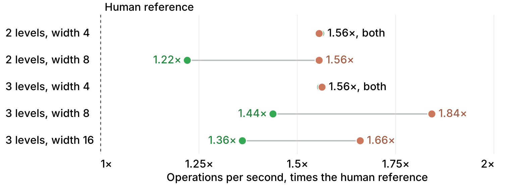
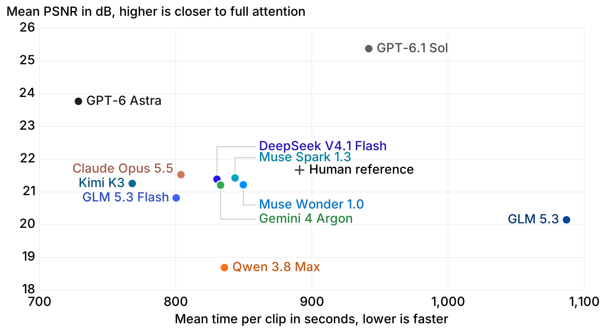
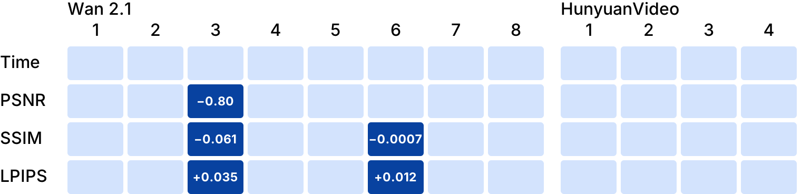

<!-- twitter -->
<meta name="twitter:title" content="Delete the Paper, Beat the Authors: Introducing FrontierCS 2">
<meta name="twitter:card" content="summary_large_image">
<!-- PRODUCTION: <meta name="twitter:image" content="https://bair.berkeley.edu/static/blog/fcs2/fcs2-card.png"> -->
<meta name="twitter:image" content="https://bairblog.github.io/assets/fcs2/fcs2-card.png">

<meta name="keywords" content="FrontierCS, benchmark, coding agents, AI for research, computer science R&D, agent evaluation">
<meta name="description" content="We took 48 published CS papers, deleted each one's key contribution from its own repository, and asked frontier agents to write it back better than the authors did. The best agent pulls it off on 28 of them.">
<meta name="author" content="The FrontierCS Team">

<p style="text-align:center;">
<i>We took 48 published CS papers, deleted each one's key contribution from its own repository, and asked frontier agents to write it back better than the authors did. The best agent pulls it off on 28 of them. The top three are within a point of each other.</i>
</p>

<p style="text-align:center;">
<a href="https://arxiv.org/abs/2610.29932">Paper</a> &middot;
<a href="https://frontier-cs.org/#leaderboard">Leaderboard</a> &middot;
<a href="https://github.com/FrontierCS/FrontierCS-2">Code</a> &middot;
<a href="https://huggingface.co/datasets/FrontierCS2/FrontierCS-2-runs">Runs on Hugging Face</a> &middot;
Blog correspondence: <a href="mailto:lihanc@berkeley.edu">lihanc@berkeley.edu</a>
</p>

<p style="text-align:center;">
<!-- PRODUCTION:  -->
<br>
<i>FrontierCS 2: 48 tasks in 13 domains, each built from a published paper.</i>
</p>

**TL;DR** FrontierCS 2 is a benchmark of 48 open-ended R&D tasks across 13 CS domains, from ML systems and HPC to databases, cryptography and robotics. Each task is a real paper's repository with the contribution removed. The agent gets five hours, a judge that scores every patch on development workloads, and one shot at the hidden suite. It passes only if its final patch beats the authors' code on every metric and every held-out workload. Across 20 models, Claude Opus 5.5 leads with 28 of 48 tasks passed (58%), with Gemini 4 Carbon and Gemini 4 Argon at 26 and Claude Sonnet 5.5 at 24.

<!--more-->

## The question we actually care about

Think about what a second-year PhD student does most weeks. They pick up a published system, inherit its codebase, swap out one component, rerun the paper's workloads, and check whether they beat the original numbers. A huge share of computer science R&D looks exactly like this. So the question we wanted to answer is not "can an agent solve a puzzle?" but "can an agent do that week of work?"

Existing benchmarks don't quite get there. Open-ended contest benchmarks, including our own FrontierCS 1, hand the agent a problem statement and grade one program after the run ends. Benchmarks that do drop the agent into a real environment tend to grade against unit tests or a leaderboard, stay inside machine learning, or compare against a rubric or a re-implementation instead of the authors' actual code. FrontierCS 2 closes that gap: the bar is the code the paper's authors released, measured on the paper's own workloads, inside the paper's own repository.

|  | **FrontierCS 1** | **FrontierCS 2** |
| :- | :- | :- |
| Task | A problem statement | A real repo with the paper's contribution deleted |
| Agent output | One program | Patches, submitted any time |
| The bar | No known optimum | The authors' code, on held-out workloads |
| Feedback during the run | None | A development-suite score for every patch |
| Coverage | Algorithms + six research areas | 13 CS domains |
| Headline metrics | Mean score | Pass rate, mean score, FCI |

## Building tasks by subtraction

Every task starts from a published paper and the code its authors released. We find the code that implements the paper's contribution, delete it, and leave everything it depends on untouched. The deleted code becomes the human reference: a private oracle that already runs in this repository on these workloads. No re-implementation, no rubric, no guessing what the authors meant.

A concrete example: **SVG-EAR**, an ECCV 2026 sparse-attention method for video diffusion. From the Sparse VideoGen repo we remove the error-aware attention class and three routines (cluster averaging, choosing which cluster pairs to compute exactly, and estimating the rest). The agent gets the repo with those functions still declared and called, and may only edit the files that held them. To pass, its latency must be at most 0.96&times; the reference's, with PSNR within 0.25 dB, SSIM within 0.01 and LPIPS within 0.005, on every held-out clip.

Pass thresholds come from the reference's own measurements. The judge scores every submission on a development suite, but the final submission is graded on a final suite that adds held-out instances (different seeds, queries or input graphs) the agent never sees.

<p style="text-align:center;">
<!-- PRODUCTION:  -->
<br>
<i>The 48 public tasks, grouped by domain: from databases, MLSys and HPC to cryptography, security and robotics.</i>
</p>

## The agent works like a researcher, not a test-taker

Inside a run, the agent holds the repository and the judge holds everything that decides the outcome: the evaluator, the hidden suite and the reference. They run in separate sandboxes connected only by a driver, and the agent's sandbox has no network access beyond it, so it cannot simply download the original code. On GPU tasks the agent can spin up its own development GPUs, while scoring happens on separate verifier hardware.

- **Five hours of wall-clock time** per run.
- **Submit a patch whenever you like.** Each one returns a development score plus a sanitized message counting how many dev workloads meet each threshold&mdash;never the reference's score or the evaluator's raw output.
- **Pick your own final answer.** At the end the agent names one patch as final, and only that patch is graded on the hidden suite. We don't rescue it by picking its best dev submission: deciding what to ship is part of research.

<p style="text-align:center;">
<!-- PRODUCTION:  -->
<br>
<i>The judge. The agent reaches only the driver; the evaluator, the held-out suite and the reference stay on the judge side.</i>
</p>

## A higher score is not a pass

A run passes only when its final patch beats the human reference on every metric and every held-out workload. That is deliberately strict. We want results the paper's authors would accept as better, not a speedup bought with a quality regression or a fit to a few workloads.

This matters more than we expected. Most runs whose combined final score beats the reference still miss a threshold somewhere. On KV Compaction, for example, Claude Opus 5.5 posts the top score and sits above the human reference, yet falls short of the reference's accuracy on 2 of 24 articles, so the run fails. A single averaged score would have called that a win.

## Results: 28 of 48 at the top, and a three-way tie on FCI

The leaderboard now covers 20 models, each paired with its own harness (Claude Code, Codex CLI and others) and run once on every task. The headline numbers:

- **Claude Opus 5.5 in Claude Code passes 28 of 48 tasks (58%).** Gemini 4 Carbon and Gemini 4 Argon follow at 26, Claude Sonnet 5.5 at 24, and GPT-6 Astra at 22. Below the top eight, no model passes more than 11.
- **A third of the benchmark is out of reach.** In the paper's 12-agent evaluation, no run passed 16 of the 48 tasks.
- **The harness is part of what we measure.** We name agents by model, but the same model in a different harness is a different agent.

<p style="text-align:center;">
<!-- PRODUCTION:  -->
<br>
<i>Tasks where each model beats the human reference on every metric and every hidden workload, out of 48.</i>
</p>

### FCI: putting agents and tasks on one scale

Pass rate treats an easy task like a hard one and saturates once a model passes everything. So we also fit the FrontierCS Capabilities Index (FCI), an item-response model forked from Epoch AI's Epoch Capabilities Index. Instead of raw scores, it learns from two things in every run: which of the task's metrics it beat, and how far its final score landed from the reference's. The same fit gives each task a FrontierCS Difficulty Index (FDI): the FCI at which an agent passes it half the time.

On FCI, the top of the board is a dead heat: Claude Opus 5.5 at 51.3, Gemini 4 Carbon at 51.0 and Claude Sonnet 5.5 at 50.7, with GPT-6 Astra and Gemini 4 Argon close behind at 48.6 and 48.4. Kimi K2.7 anchors the scale, and ten points equal one logit, so a three-way gap of 0.6 points is far inside the bootstrap intervals. The more interesting finding is on the task side: the median task sits at roughly the strongest agent's FCI. The benchmark spans a wider difficulty range than the agents do, so there is real headroom above today's best.

<p style="text-align:center;">
<!-- PRODUCTION:  -->
<br>
<i>FrontierCS Capabilities Index (FCI) on the 48 public tasks.</i>
</p>

### What a pass costs

Pass rate alone hides a 400&times; spread in cost. The top cluster (Claude Opus 5.5, both Gemini 4 models, Claude Sonnet 5.5 and GPT-6 Astra) all spend roughly <span class="tex2jax_ignore">\$17&ndash;40</span> per run, with Gemini 4 Carbon the most expensive of the group for two fewer passes than Opus. The value pick is GPT-6.1: Terra and Sol pass about 40% of tasks for around <span class="tex2jax_ignore">\$3</span> a run, roughly a sixth of the frontier's cost. At the far left, DeepSeek V4.1 Flash costs about a dime per run and still passes about one task in eight.

<p style="text-align:center;">
<!-- PRODUCTION:  -->
<br>
<i>Pass rate against mean cost per run (US$, log scale). Costs are estimates; Gemini 4 Carbon is priced at Gemini 4 Argon's rates.</i>
</p>

### The leader depends on your budget

In the paper's cost analysis, capping spending per run changes the ranking. A run still going when the budget runs out counts as having no final submission. At the smallest budgets, DeepSeek V4.1 Flash leads (with the caveat that its costs are lower bounds and depend on token pricing); at the largest, Claude Opus 5.5 does.

## What the agents actually invented

Pass rates tell you how often. Reading the patches tells you what. Three runs stood out, each with its own deep-dive post.

**Two checksums shrink private lookups by 27%.** In QuarterPIR, a private information retrieval scheme, the reference server returns a parity value for every database group, though the client needs only one. Muse Wonder 1.0 replaced them with two checksums, the same construction RAID-6 uses to rebuild two failed disks. Because the client already knows the only two groups where its values can differ, two checksums suffice. Bytes per lookup fell from 1,760 to 1,280, with privacy unchanged. [Read the deep dive &rarr;](https://frontier-cs.org/blog/quarterpir-two-checksums/)

<p style="text-align:center;">
<!-- PRODUCTION:  -->
<br>
<i>QuarterPIR: bytes per lookup at 67 million entries. Hollow points fail the task.</i>
</p>

**Two faster clocks for a hardware priority queue.** BBQ is an FPGA priority queue for packet scheduling. Gemini 4 Argon kept the memory layout but resolved the read-after-write check while the read was still in flight. Claude Opus 5.5 moved every counter into registers and updated a whole tree level per cycle&mdash;up to 1.84&times; the reference's operations per second, versus 1.56&times; for Argon at the same memory. The catch: Opus's circuit is among the largest, and the final score doesn't charge for size. [Read the deep dive &rarr;](https://frontier-cs.org/blog/bbq-two-faster-clocks/)

<p style="text-align:center;">
<!-- PRODUCTION:  -->
<br>
<i>BBQ: operations per second as a multiple of the human reference, by tree size. Green: Gemini 4 Argon. Orange: Claude Opus 5.5.</i>
</p>

**The baseline no model could beat.** On SVG-EAR, nobody passed. GPT-6 Astra came closest by measuring attention error rather than predicting it, picking the smallest per-head budget under an error bound, and fixing a centroid-estimate bias the paper leaves in. It was faster on every clip and closer to full attention on average&mdash;and still failed image quality on two clips, clearing 43 of 48 checks. Speed was never the bottleneck on this task; quality bands were. [Read the deep dive &rarr;](https://frontier-cs.org/blog/svg-ear-measured-error/)

<p style="text-align:center;">
<!-- PRODUCTION:  -->
<br>
<i>SVG-EAR: mean PSNR against mean time per clip on the twelve hidden clips. No run passes.</i>
</p>

<p style="text-align:center;">
<!-- PRODUCTION:  -->
<br>
<i>GPT-6 Astra's 48 checks on SVG-EAR: 43 passed, with misses on two Wan 2.1 clips.</i>
</p>

## What our metrics still miss

The case studies are also a confession. The pass/fail bit can't tell a 27% byte reduction from a marginal one; on QuarterPIR, GPT-6.1 Sol actually scores slightly higher than Muse Wonder with a much smaller saving. The final score on BBQ rewards speed and ignores circuit area. On SVG-EAR, a run that is better on average fails on two clips. We think benchmarks of this kind need to report side costs like these next to the pass, and that FCI with honest intervals is a better summary than any single averaged number.

## Run it, submit to it, help us extend it

- **Run it yourself.** All 48 tasks, evaluators and the judge are public at [github.com/FrontierCS/FrontierCS-2](https://github.com/FrontierCS/FrontierCS-2). It installs into your own AWS account; GPU tasks also use Modal, and any OpenAI-compatible model endpoint works.
- **Know the cost.** A full 48-task evaluation of Claude Opus 5.5 runs about <span class="tex2jax_ignore">\$1,000</span> in API fees, <span class="tex2jax_ignore">\$300</span> in GPU time and <span class="tex2jax_ignore">\$100</span> in CPU.
- **Get on the leaderboard.** Email per-task scores to both [qmang@berkeley.edu](mailto:qmang@berkeley.edu) and [wenhao.chai@princeton.edu](mailto:wenhao.chai@princeton.edu).
- **Inspect every run.** Full trajectories are on [Hugging Face](https://huggingface.co/datasets/FrontierCS2/FrontierCS-2-runs) and the Kaggle benchmark page.
- **A private set is coming.** Beyond the public 48, we hold more than 100 private tasks, to be announced later, so the benchmark stays ahead of contamination.

## Acknowledgments

Special thanks to Modal, our lead sponsor, for the compute behind FrontierCS 2, and to Kaggle, the Laude Institute's Slingshot program, Scale AI, Handshake and Snorkel AI for their support. Thanks to Epoch AI for the ECI and its released code, and to the authors of all 48 source papers whose open code made these tasks possible.

## Citation

```
@misc{mang2026frontiercs2benchmarkcomputer,
      title={FrontierCS 2: A Benchmark for Computer Science R\&D},
      author={Qiuyang Mang and Wenhao Chai and Runyuan He and Dongruixuan Li and Zihan Zheng and Yujun He and Xuanyi Zhou and Hao Wang and Siddhant Ray and Bo Peng and Ruyi Ji and Shuo Yang and Haocheng Xi and Boru Chen and Xinyang David Han and Melissa Pan and Mayank Mishra and Boxi Yu and Sijia Liu and Kerem Akillioglu and Yi Pan and Zirui Wang and Mert Cemri and Diogo Antunes and Yichuan Wang and Aiwei Ivy Zhang and Zhenyang Chen and Qizheng Zhang and Kaiyuan Liu and Wenyuan Huang and Sherry Ruan and Shu Liu and Dacheng Li and Zerui Cheng and Zeyu Shen and Shang Zhou and Hanfei Chen and Yuzhong Zhang and Bohan Lyu and Qu Ao and Han Zheng and Chonghe Jiang and Jingzhuo Hu and Xiaokun Chen and Kunjun Li and Zhiqing Zhong and Haoye Tian and Tong Zhao and Yunzhong He and Hanchen Li and Ofir Press and Jiantao Jiao and Kunle Olukotun and Karthik R. Narasimhan and Jingbo Shang and Koushik Sen and Matei Zaharia and Alex Dimakis and Ion Stoica and Joseph E. Gonzalez and Alvin Cheung},
      year={2026},
      eprint={2610.29932},
      archivePrefix={arXiv},
      primaryClass={cs.LG},
      url={https://arxiv.org/abs/2610.29932},
}
```
